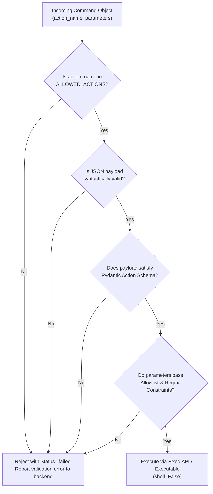

# ServicePulse Native Windows Agent — Security Architecture & Hardening Guide

**Author:** Muhammadyusuf Usmonov  
**Academic Purpose:** TATU AT-Servis BMI  
**Component:** Endpoint Agent Security Model  
**Classification:** Enterprise IT Security Documentation

---

## 1. Security Philosophy & Principles

The ServicePulse Agent is engineered according to five core security tenets:

1. **Least Privilege Operation:** Everyday telemetry gathering and keepalive heartbeats require zero administrative privileges. Elevation is required exclusively during initial Windows Service registration and privileged OS service restarts.
2. **Mathematical Defense Against Remote Code Execution:** The Agent **never** executes arbitrary shell strings received from the backend. The Python parameter `shell=True` is prohibited throughout the entire codebase.
3. **Hardware-Tied Credential Storage:** Agent bearer tokens and credentials are never stored in plaintext JSON, XML, or configuration files. They are encrypted using the Windows Data Protection API (DPAPI).
4. **Strict Parameter Validation:** Every incoming command parameter must pass validation against a strict Pydantic model with regular expression constraints before dispatch.
5. **Redaction of Sensitive Data:** Loggers automatically sanitize and redact passwords, bearer tokens, enrollment secrets, and Windows product keys from log streams.

---

## 2. Threat Model & Mitigations

| Threat | Impact | Agent Mitigation Strategy |
| :--- | :--- | :--- |
| **Credential Theft via Disk Forensics** | Compromised agent identity | Credentials in `%ProgramData%\ServicePulse\credentials.dat` are encrypted with DPAPI machine/user keys. Unencrypted tokens exist only ephemerally in RAM. |
| **Command Injection via Compromised Server** | Remote arbitrary execution on endpoints | No shell interpreter is invoked. Executables and actions are limited to fixed binaries (`sc.exe`, `ping.exe`) with controlled argument lists and regex whitelisting. |
| **Prohibited System Service Denial of Service** | Endpoint OS crash (`lsass.exe`, `csrss.exe`) | Strict blacklist (`PROHIBITED_SERVICES`) and whitelist (`ALLOWED_SERVICES`) reject any restart targeting critical Windows components. |
| **Unapproved Software Installation** | Malicious binary staging | Software requests are validated against the approved enterprise catalog (`APPROVED_SOFTWARE_CATALOG`). Arbitrary URLs and executables are rejected. |
| **Token Eavesdropping** | Man-in-the-Middle credential interception | Production mode enforces HTTPS and TLS certificate verification (`verify_ssl=True`). |
| **Secret Leakage via Diagnostic Logs** | Exposure of tokens in support logs | Custom `SensitiveFilter` scans all log records with regular expressions and redacts tokens to `[REDACTED_TOKEN]`. |

---

## 3. Windows DPAPI Credential Storage & Security Boundary

Sensitive credentials generated during enrollment:

```json
{
  "agent_uuid": "agent_8db6a41e8def4d62",
  "api_token": "sp_tok_...",
  "device_id": 42,
  "organization_id": 1
}
```

Are encrypted via `win32crypt.CryptProtectData` using machine scope (`0x5` = `0x1 | 0x4`):

```python
encrypted = win32crypt.CryptProtectData(
    plaintext,
    "ServicePulse Agent Credentials",
    None,  # Optional entropy
    None,  # Reserved
    None,  # Prompt struct
    0x5    # CRYPTPROTECT_UI_FORBIDDEN (0x1) | CRYPTPROTECT_LOCAL_MACHINE (0x4)
)
```

### 3.1 DPAPI Scope Comparison: Machine-Scope vs. User-Scope

| Dimension | Default User-Scope DPAPI (`0x0` / `0x1`) | Machine-Scope DPAPI (`0x5` = `0x1 \| 0x4`) |
|---|---|---|
| **Flags Definition** | `0x0` (default user-scope) or `0x1` (`CRYPTPROTECT_UI_FORBIDDEN` without `0x4`) | `0x5` = `CRYPTPROTECT_UI_FORBIDDEN` (`0x1`) \| `CRYPTPROTECT_LOCAL_MACHINE` (`0x4`) |
| **Key Derivation** | MasterKey derived from specific user password/SID in `%APPDATA%\Microsoft\Protect\{SID}` | Machine LSA key in `%SystemRoot%\System32\Microsoft\Protect\{Machine-GUID}` |
| **Decryption Boundary** | Only processes running in that specific user session | Any process running on the local endpoint (SYSTEM, Admins, Services) |
| **Service Decryption** | **Fails** when background Windows Service runs under `NT AUTHORITY\SYSTEM` | **Succeeds**: Background Windows Service and Administrator can both decrypt across reboots |
| **Offline Defense** | Protected if disk or VM image is extracted | Protected if disk or VM image is extracted |
| **Local User Defense** | Cryptographically bound to the user profile | **Requires NTFS DACL enforcement** to prevent standard users from reading file |

### 3.2 Operating System Access Control (NTFS DACL)
Because machine-scoped DPAPI allows any local process with file read permissions to decrypt, the primary security boundary against non-administrative local users is enforced by Windows NTFS Access Control Lists (DACLs) applied to both the parent directory and the credentials file using exact Windows SIDs:

```powershell
# 1. Secure Parent Directory (%ProgramData%\ServicePulse)
# Strips inherited permissions and grants FullControl with Object/Container inherit
icacls.exe "C:\ProgramData\ServicePulse" /inheritance:r /grant:r "*S-1-5-18:(OI)(CI)(F)" "*S-1-5-32-544:(OI)(CI)(F)" "*$UserSID:(OI)(CI)(F)"

# 2. Secure Credential File (credentials.dat)
icacls.exe "C:\ProgramData\ServicePulse\credentials.dat" /inheritance:r /grant:r "*S-1-5-18:(F)" "*S-1-5-32-544:(F)" "*$UserSID:(F)"
```
- `*S-1-5-18`: `NT AUTHORITY\SYSTEM` (Full Control)
- `*S-1-5-32-544`: `BUILTIN\Administrators` (Full Control)
- `*$UserSID`: Current user's specific Windows SID (e.g. `*S-1-5-21-...:(F)`), resolving language-independently and working seamlessly in PowerShell and CMD without relying on `%USERNAME%` expansion.
- `/inheritance:r`: Strips all inherited permissions, explicitly removing `BUILTIN\Users` (`*S-1-5-32-545`) and `Everyone`.
- Standard, non-elevated user accounts receive `Access is Denied` (Win32 Error 5 / `PermissionError: [Errno 13]`) at the OS filesystem layer. Temporary `.tmp` files are hardened during creation and cleaned up immediately.

### 3.3 Windows Service Privileges & Least Privilege Analysis
- **Service Identity:** The background service runs under `NT AUTHORITY\LocalSystem`.
- **Privilege Breakdown by Operation:**
  - *Standard Privileges Sufficient:* Host CPU, RAM, Disk, Uptime, Network IP probing, and offline SQLite queueing can run under an unprivileged user context.
  - *Elevated / System Privileges Mandated:*
    1. **Service Control Manager (SCM):** Stopping/starting allowlisted OS services (`wuauserv`, `spooler`, `bits`, `w32time`) requires `SERVICE_START` and `SERVICE_STOP` rights in the service's DACL, restricted by Windows to `SYSTEM` and `Administrators`. Unprivileged accounts receive Win32 Error 5 (`Access is Denied`).
    2. **Defender & Licensing Diagnostics:** Querying `Get-MpComputerStatus` (WMI namespace `root\Microsoft\Windows\Defender`) and CIM `SoftwareLicensingProduct` requires administrative integrity; unprivileged accounts receive WMI Access Denied.
    3. **Enterprise Package Deployment:** System-wide software installations write to `%ProgramFiles%` and `HKLM\Software`, requiring administrative access.
- **Evaluation of Restricted Service Accounts:**
  - Running under `NT AUTHORITY\LocalService` or `NT AUTHORITY\NetworkService` would satisfy passive metrics but fundamentally disable automated remediation and security telemetry.
  - A potential future architectural refinement is a dual-process model (unprivileged telemetry collector process + privileged remediation helper process communicating over an authenticated local named pipe). For STEP 4, maintaining single-service simplicity while enforcing strict application-layer gates prevents architectural instability.
- **Application-Layer Least Privilege Guardrails:**
  - Local strict action allowlist (`ALLOWED_ACTIONS`) and service allowlist (`ALLOWED_SERVICES`).
  - Prohibited core OS services (`lsass`, `csrss`, `smss`, `wininit`, etc.) cannot be targeted.
  - Complete prohibition of `shell=True` and shell metacharacters.
  - Cryptographic SHA-256 and Authenticode digital signature verification.
  - Service is not installed globally on the host computer without explicit approval.

---

## 4. Local Command Allowlist & Parameter Schemas

When a command arrives from the backend via `GET /api/v1/agent/me/commands`, the `CommandDispatcher` enforces a multi-tier gate:



### Allowlisted Actions & Schemas:

1. **`restart_service`**
   - **Allowed services:** `wuauserv`, `spooler`, `ServicePulseAgent`, `w32time`, `dnscache`, `lanmanworkstation`, `audiosrv`, `themes`, `bits`, `wscsvc`.
   - **Prohibited services:** `lsass`, `csrss`, `smss`, `winlogon`, `services`, `system`, `registry`, `samss`.
   - **Regex rule:** `^[a-zA-Z0-9_\-\.]{1,64}$`

2. **`restart_servicepulse_agent`**
   - **Allowed parameters:** `{"reason": str, "delay_seconds": int}`
   - **Safety behavior:** Defers restart via timer; prevents immediate self-termination loops.

3. **`run_diagnostic_check`**
   - **Allowed check types:** `ping`, `dns`, `tcp`, `disk`, `service`.
   - **Regex rule on targets:** `^[a-zA-Z0-9\.\-_]{1,150}$`

4. **`recheck_network_endpoint`**
   - **Allowed protocols:** `icmp`, `tcp`.
   - **Allowed ports:** `1` through `65535`.
   - **Target validation:** Strictly validated IPv4/hostname regex.

5. **`notify_administrator`**
   - **Severity choices:** `info`, `warning`, `critical`.
   - **Maximum length:** 500 characters.

6. **`install_approved_software`**
   - **Approved catalog:** `7-Zip`, `Google Chrome`, `Mozilla Firefox`, `Visual Studio Code`, `Git`, `Python`, `Node.js`, `LibreOffice`, `VLC Media Player`, `Wireshark`, `PuTTY`, `WinSCP`.
   - **Version regex:** `^[a-zA-Z0-9\.\-_+]{1,30}$` (Disallows quotes, pipes, semicolons, ampersands).

---

## 5. Arbitrary Execution Protection (`shell=False`)

Every invocation of external system tools in `CommandExecutor` uses structured argument lists passed directly to the operating system's process creation API (`CreateProcessW`):

```python
# SECURE: No cmd.exe or powershell.exe shell interpretation
subprocess.run(
    ["sc.exe", "query", service_name],
    capture_output=True,
    text=True,
    shell=False,  # STRICT REQUIREMENT
    timeout=10,
    check=False
)
```

Arguments containing spaces, quotes, or metacharacters cannot break out of their argument positions or execute subcommands.
