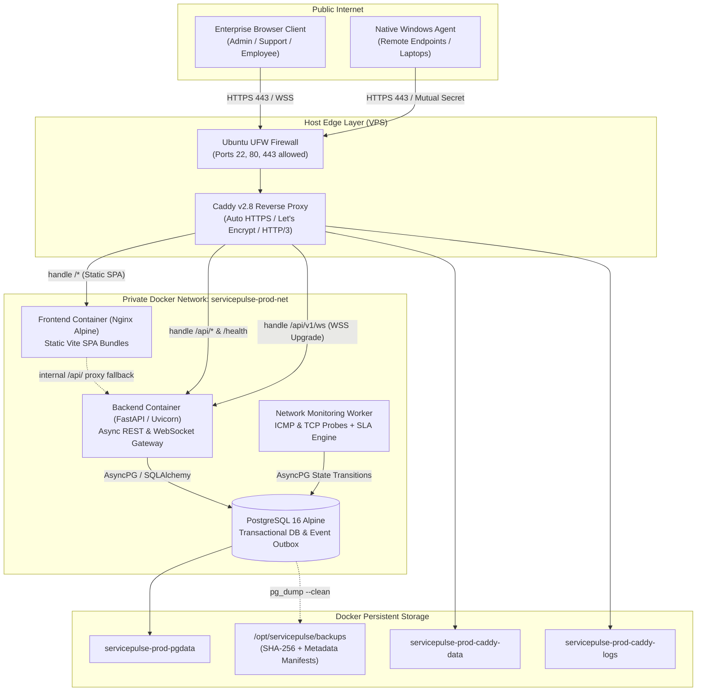

# ServicePulse — Production Deployment Guide
**Enterprise Hybrid Remote Monitoring & Management (RMM) and IT Service Management (ITSM)**  
**Author:** Muhammadyusuf Usmonov  
**Academic Purpose:** Graduation Qualification Work (BMI), Tashkent University of Information Technologies (TUIT) & AT-Servis  
**Target Environment:** Ubuntu 24.04 / 22.04 LTS VPS  
**Target Domain:** `https://servicepulse.uz`

---

## 1. Production Architecture Overview

ServicePulse employs a containerized, defense-in-depth microservices architecture designed for low-overhead, multi-tenant enterprise operations. All services run inside an isolated Docker network (`servicepulse-prod-net`), exposing **only** standard HTTP (80) and HTTPS (443) ports via Caddy reverse proxy.



### Component Roles & Boundaries

| Component | Image / Base | Internal Address | Host Port Exposure | Security Role |
| :--- | :--- | :--- | :--- | :--- |
| **Caddy** | `caddy:2.8-alpine` | `caddy` | `80:80`, `443:443`, `443:443/udp` | TLS termination, ACME renewal, HSTS, CSP, and reverse proxy routing. |
| **Frontend** | Multi-stage `nginx:alpine` | `frontend:80` | None (Internal) | High-performance SPA delivery, client-side routing, static caching. |
| **Backend** | `python:3.12-slim` | `backend:8000` | None (Internal) | FastAPI async API gateway, RBAC enforcement, WebSocket outbox consumer. |
| **Network Worker** | `python:3.12-slim` | `network-worker` | None (Internal) | Autonomous ICMP/TCP probes, SLA metrics, transactional outbox producer. |
| **Database** | `postgres:16-alpine` | `db:5432` | None (Internal) | Relational multi-tenant data store, ACID transactions, event outbox table. |

---

## 2. Server Prerequisites

### 2.1 Hardware Requirements
- **CPU:** 2 vCPU cores minimum (4 vCPU recommended for high agent concurrency).
- **RAM:** 4 GB RAM minimum (8 GB recommended for caching & background jobs).
- **Disk:** 40 GB NVMe / SSD storage minimum.
- **Operating System:** Ubuntu 24.04 LTS or Ubuntu 22.04 LTS.

### 2.2 Domain & DNS Configuration
Ensure DNS `A` records point to your VPS public IPv4 address:
```dns
servicepulse.uz.        IN  A   <YOUR_SERVER_IPV4>
www.servicepulse.uz.    IN  A   <YOUR_SERVER_IPV4>
```

---

## 3. Server Initialization & Hardening

Log in to the server via SSH as `root` or a `sudo` user:

```bash
# 1. Clone repository to /opt/servicepulse
sudo git clone https://github.com/Muhammadyusuf0807/ServicePulse.git /opt/servicepulse
cd /opt/servicepulse

# 2. Execute automated server hardening script
sudo bash scripts/harden-server.sh 22
```

The hardening script applies:
- Default `deny incoming` firewall policy via UFW.
- Allowed ports: `22/tcp` (SSH), `80/tcp` (HTTP ACME), `443/tcp` (HTTPS), `443/udp` (HTTP/3 QUIC).
- SSH security baseline (`PermitRootLogin prohibit-password`, `PasswordAuthentication no`, `MaxAuthTries 3`).
- Docker daemon hardening (`/etc/docker/daemon.json` with log rotation).
- Fail2ban intrusion prevention jail for SSH.
- Unattended automatic security updates (`unattended-upgrades`).
- Kernel `sysctl` TCP SYN flood & IP spoofing protections.

---

## 4. Production Configuration & Secrets

### 4.1 Automated Secret Generation
Generate cryptographically strong production secrets using the built-in generator:

```bash
cd /opt/servicepulse
bash scripts/generate-secrets.sh
```

This generates `.env.production` from `infra/env/.env.production.template` with:
- 64-character hexadecimal `SECRET_KEY` for JWT tokens.
- 44-character URL-safe `AGENT_ENROLLMENT_SECRET`.
- 32-character high-entropy `POSTGRES_PASSWORD`.
- Initial administrative passwords for Superuser, Support, and Employee roles.
- Restrictive file permissions (`chmod 600 .env.production`).

### 4.2 Verify Secret Compliance
```bash
python3 scripts/generate_secrets.py --check .env.production
```

---

## 5. Deployment Execution

Execute the automated zero-touch deployment script:

```bash
sudo bash scripts/deploy.sh
```

### Deployment Pipeline Stages:
1. **Pre-flight Checks:** Verifies `.env.production` and validates secret strength.
2. **Permission Lockdown:** Enforces `chmod 600` on secrets and `chmod 700` on backups.
3. **Safety Dump:** Automatically takes a pre-deployment PostgreSQL backup if a database container is active.
4. **Container Build:** Builds multi-stage production images with cached layers.
5. **Database Initialization & Migrations:** Runs `alembic upgrade head` and seeds core role permissions.
6. **Health Verification:** Polls container probes until all services report healthy.

---

## 6. Operational Telemetry & Monitoring

Inspect live platform health, container states, database performance, and storage metrics:

```bash
python3 scripts/check_health.py
```

### Viewing Container Logs with Rotation
All containers use the `json-file` log driver with `max-size: 20m` and `max-file: 5`:

```bash
# View all recent logs
docker compose -f compose.prod.yaml logs --tail=100 -f

# View backend API logs
docker compose -f compose.prod.yaml logs -f backend

# View network monitoring worker logs
docker compose -f compose.prod.yaml logs -f network-worker

# View Caddy access logs
docker compose -f compose.prod.yaml logs -f caddy
```

---

## 7. Windows Agent Deployment

Install the ServicePulse Windows Agent on managed endpoints:

1. Download `ServicePulseAgent.exe` from the ServicePulse releases or compile from source:
   ```powershell
   python agent\build_agent.py
   ```
2. Prepare `config.json` on the target machine (`C:\ProgramData\ServicePulse\config.json`):
   ```json
   {
     "server_url": "https://servicepulse.uz",
     "agent_name": "LAB-PC01",
     "heartbeat_interval_seconds": 30,
     "telemetry_interval_seconds": 60,
     "verify_ssl": true
   }
   ```
3. Install and start as a Windows Service with administrative privileges:
   ```cmd
   ServicePulseAgent.exe --install --enrollment-secret <YOUR_ENROLLMENT_SECRET>
   ServicePulseAgent.exe --start
   ```

---

## 8. Zero-Downtime Rolling Upgrades

To deploy a software update without disrupting user sessions or monitoring:

```bash
cd /opt/servicepulse

# 1. Fetch latest changes
git pull origin feature/step-5-4-production-readiness

# 2. Run automated deployment routine
sudo bash scripts/deploy.sh
```
The script automatically takes a safety backup before building and restarting services.
