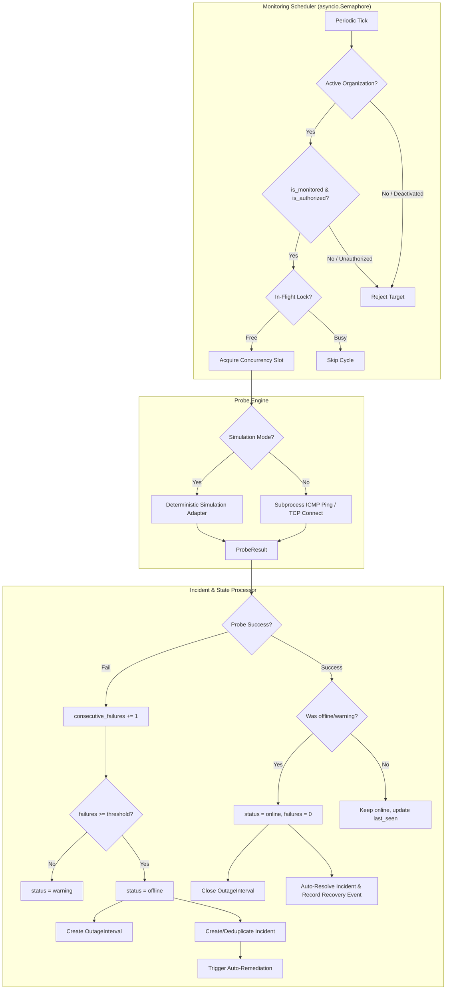

# ServicePulse Network Monitoring Worker & Engine Specification

**Author:** Muhammadyusuf Usmonov  
**Project:** ServicePulse — Enterprise Hybrid RMM & ITSM Platform  
**Component:** Independent Network Worker & Probe Engine  
**Version:** 3.0.0  

---

## 1. Architectural Overview

The ServicePulse Network Monitoring Worker is a dedicated background daemon (`network-worker`) that executes completely independently from the FastAPI application. It is containerized in Docker Compose (`servicepulse-network-worker`) and continuously evaluates the reachability, latency, and operational health of all authorized network devices across active tenants.

---

## 2. Multi-Tenant Authorization & Security Controls

Network probing strictly enforces organizational boundaries and administrative authorization:

1. **Active Organization Verification:**
   - Probes are only dispatched for devices belonging to active organizations (`organization.is_active == True`).
   - If an organization is deactivated, its devices are immediately excluded from scheduling.

2. **Explicit Device Authorization:**
   - Probing requires both `device.is_monitored == True` and `device.monitoring_config.is_authorized == True`.
   - Unauthorized targets, loopback addresses, or non-inventoried IPs are rejected at the scheduler boundary.

3. **Multi-Tenant API Scoping:**
   - Network endpoints (`/api/v1/network/*`) enforce role-based access control (RBAC).
   - SysAdmin and Company Admin users can only query checks, trigger probes, and manage configurations for devices in their own organization.
   - Platform Super Admins can monitor and query across all organizations.

---

## 3. Probe Engine Mechanics

The probe engine (`backend/app/workers/probe_engine.py`) supports two core network protocols with strict timeouts:

### 3.1. Non-Privileged ICMP Ping
- Uses the system `ping` utility via non-privileged asynchronous subprocesses (`asyncio.create_subprocess_exec`).
- Supports cross-platform execution (Linux `-c 1 -W timeout` and Windows `-n 1 -w timeout_ms`).
- Parses exit codes and stdout to extract round-trip latency in milliseconds and packet loss percentages.

### 3.2. TCP Port Probe
- Implements asynchronous socket connections via `asyncio.wait_for(asyncio.open_connection(ip, port), timeout)`.
- Measures precise handshake latency.
- Supported ports include HTTP (80), HTTPS (443), RTSP (554), WinBox (8291), SSH (22), and DNS (53).

### 3.3. Deterministic Simulation Adapter
- Sample demonstration devices (e.g. subnet `192.168.10.0/24` or devices marked `simulation_mode=True` or `is_sample_data=True`) utilize the deterministic simulation adapter.
- Returns realistic latency (1.5ms - 4.2ms) without sending raw packets to non-routable demonstration addresses.
- All simulated probe results are explicitly tagged with `is_simulated = True` in the database and audit trail.

---

## 4. State Transitions & Outage Tracking

Device status transitions are managed by `NetworkIncidentProcessor`:

| From Status | Condition | To Status | Side Effects |
|---|---|---|---|
| `online` | 1 probe failure | `warning` | `consecutive_failures = 1`. State transition logged. |
| `warning` | `< threshold` consecutive failures | `warning` | `consecutive_failures` incremented. State transition logged. |
| `warning` / `online` | `>= threshold` (default 3) failures | `offline` | Status set to `offline`. `OutageInterval` created. Incident opened with deduplication. Remediation triggered. |
| `offline` | Continued probe failure | `offline` | Deduplicated to existing open incident. `occurrence_count` incremented. |
| `offline` / `warning` | 1 successful probe | `online` | Status set to `online`, `consecutive_failures = 0`. Active `OutageInterval` closed (`duration_seconds` calculated). Incident auto-resolved. |

---

## 5. Scheduler & Concurrency Controls

The scheduler (`backend/app/workers/scheduler.py`) provides production-grade concurrency safety:

- **Bounded Concurrency:** Configured with `asyncio.Semaphore(max_concurrency)` (default: 20 concurrent probes) to prevent socket exhaustion and excessive resource consumption.
- **In-Flight Device Locks:** Maintains an active set of device IDs currently being probed. If a probe for device X takes longer than the check interval, subsequent iterations skip device X until the prior probe finishes, completely preventing overlapping probes.
- **Configurable Intervals:** Default check interval is 30 seconds (configurable per device via `DeviceMonitoringConfig.check_interval_seconds`).
