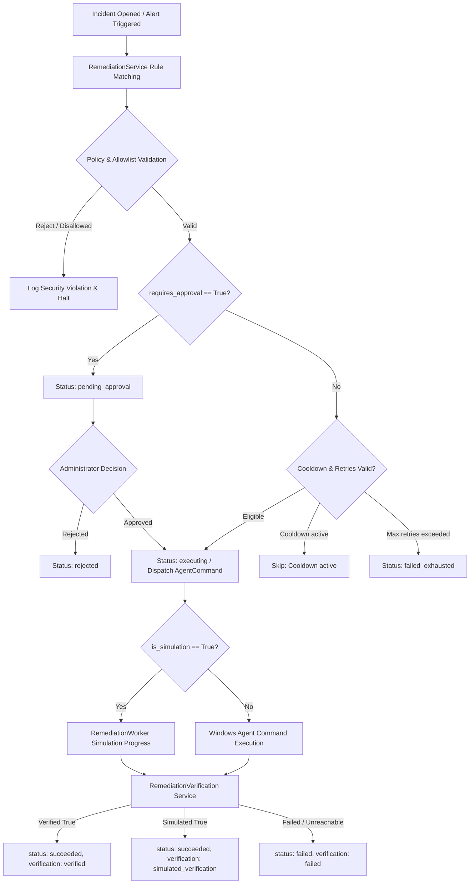

# ServicePulse Automated Remediation Engine Specification

**Author:** Muhammadyusuf Usmonov  
**Project:** ServicePulse — Enterprise Hybrid RMM & ITSM Platform  
**Component:** Automated Remediation Engine & Verification Service  
**Version:** 3.0.0  

---

## 1. Engine Architecture & Closed-Loop Remediation

The ServicePulse Automated Remediation Engine bridges network incidents and administrative response actions through a strictly controlled, closed-loop execution pipeline:

---

## 2. Action Allowlist & Strictly Typed Parameter Schemas

To guarantee immunity against remote code execution (RCE) and arbitrary shell injection, **no raw command lines or arbitrary shell scripts are permitted**. All remediation actions must belong to the strict allowlist and validate against Pydantic parameter schemas:

| Action Name | Parameter Schema | Default Behavior / Constraints |
|---|---|---|
| `restart_service` | `RestartServiceParams(service_name, timeout_seconds)` | Defaults to `ServicePulseAgent`. Alphanumeric service name pattern `^[a-zA-Z0-9_\-\. ]+$`. |
| `restart_servicepulse_agent` | `RestartAgentParams(timeout_seconds)` | Self-restart of ServicePulse Windows service. Timeout 5–120s. |
| `run_diagnostic_check` | `RunDiagnosticParams(diagnostic_type, include_event_logs)` | Allowed types: `network_summary`, `service_status`, `disk_health`. |
| `recheck_network_endpoint` | `RecheckNetworkParams(port, timeout_seconds)` | Immediate network probe recheck on designated port. |
| `notify_administrator` | `NotifyAdminParams(channel, message)` | Channels: `dashboard`, `email`, `sms`. Default message provided if omitted. |

Arbitrary action names (e.g., `execute_shell`, `powershell_script`) return `400 Bad Request` at the API boundary and are rejected by `RemediationPolicy.validate_action()`.

---

## 3. Approval Workflows & Role-Based Authorization

1. **Requires Approval Flag:**
   - When `RemediationRule.requires_approval == True`, triggering incidents create a `RemediationExecution` in `status="pending_approval"`.
   - The execution is halted until an authorized administrator explicitly reviews and acts upon it.

2. **Approval Roles:**
   - Dedicated approver endpoints:
     - `POST /api/v1/remediations/executions/{id}/approve`
     - `POST /api/v1/remediations/executions/{id}/reject`
   - Authorized approver roles: `platform_super_admin`, `company_admin`, `it_admin`, `admin`.
   - Multi-tenant boundary is enforced: Company Admins cannot approve executions outside their tenant organization.

3. **Execution Auditing:**
   - Approval notes, reviewing administrator user ID, and exact timestamps are recorded directly on the execution record.

---

## 4. Observable Evidence Verification

The `RemediationVerification` service validates that an action produced measurable recovery before declaring success:

1. **Service Restarts:** Queries subsequent agent telemetry or Windows service state to confirm the target service transitioned to `running`.
2. **Network Rechecks:** Issues an on-demand probe immediately following remediation to confirm target endpoint reachability.
3. **Agent Absence:** If a device is offline and has no active enrolled agent, verification returns `verification_status="unavailable"` and logs that physical inspection or manual network intervention is required.
4. **Independent Verification Check:** Supported via `POST /api/v1/remediations/executions/{id}/verify`.

---

## 5. Safe Simulation Mode Guarantees

For testing, demonstration, and staging environments:

1. **Strictly Flagged:** All simulated executions, commands, and probe results carry explicit `is_simulation = True` flags in the database.
2. **Never Counted as Production Success:** Simulated verification is recorded as `verification_status = "simulated_verification"`. The log explicitly states `"Simulation test successful. Not counted as production success."`
3. **Executive Dashboard Integrity:** Contractual SLA reports and executive uptime percentages only evaluate verified, non-simulated production records.
