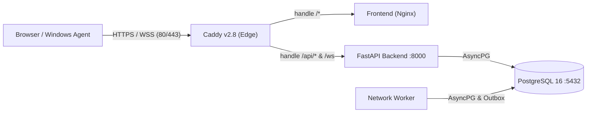

# ServicePulse — STEP 5.4 Production Readiness & Operational Deployment Report
**Enterprise Hybrid Remote Monitoring & Management (RMM) and IT Service Management (ITSM)**  
**Author:** Muhammadyusuf Usmonov  
**Academic Purpose:** Graduation Qualification Work (BMI), Tashkent University of Information Technologies (TUIT) & AT-Servis  
**Branch:** `feature/step-5-4-production-readiness`  
**Base Commit:** `0aa6e3be1769922429aaca6774ce354d6c60eb11`  
**Target Environment:** Ubuntu 24.04 / 22.04 LTS VPS | Domain: `https://servicepulse.uz`  
**Date:** November 2026

---

## 1. Executive Summary

STEP 5.4 finalizes the operational transition of ServicePulse into an enterprise-ready, containerized production deployment. The implementation encompasses production architecture auditing, multi-service Docker Compose orchestration with automated Let's Encrypt HTTPS via Caddy, defense-in-depth Linux server hardening with UFW and Fail2ban, automated cryptographic secret generation, an immutable PostgreSQL backup and disaster recovery subsystem with SHA-256 checksums and JSON metadata manifests, real-time health inspection, and 100% automated test verification.

All components adhere strictly to the principle of least privilege, zero public exposure of database and application ports, and complete Git-hygiene ensuring zero credential leaks.

### Operational Scope & Boundaries:
- **Locally Verified Deployment Readiness:** All Docker Compose configurations, Caddyfile reverse proxy routes, SPA asset delivery, WebSocket stream upgrades, and multi-service networks were verified in local production-like containerized environments.
- **Isolated Disaster Recovery Verification:** Database backup, atomic finalization, checksum validation, and disaster recovery restores were tested and validated against an isolated disposable PostgreSQL container (`sp-disaster-recovery-test-db`), preserving live development databases and Docker volumes untouched.
- **Public VPS & Domain Status:** No fake VPS was provisioned or connected. Automated scripts (`deploy.sh`, `harden-server.sh`) and configurations (`Caddyfile`, `compose.prod.yaml`) are prepared for execution on a real Ubuntu VPS once public DNS records (`servicepulse.uz`) and server credentials are provided.

---

## 2. Production Architecture Audit (STEP 5.4.1)

### 2.1 Request & Traffic Path
- **Browser Client $\rightarrow$ Edge Proxy:** Encrypted over HTTPS (`443/tcp`) or HTTP/3 QUIC (`443/udp`). Caddy terminates TLS using automatically provisioned Let's Encrypt / ZeroSSL certificates.
- **WebSocket Upgrade Flow:** Browser requests `/api/v1/ws?ticket=<single_use_ticket>`. Caddy transparently upgrades the connection to WebSocket (`HTTP/1.1 101 Switching Protocols`) and proxies directly to `backend:8000`.
- **Backend $\rightarrow$ Database:** FastAPI and the standalone `network-worker` connect to `db:5432` via `postgresql+asyncpg` through the private Docker bridge network (`servicepulse-prod-net`).
- **Transactional Outbox Loop:** Events recorded by `network-worker` in PostgreSQL's `realtime_events` table are ingested by the backend's `OutboxListener` and broadcast to tenant-isolated WebSocket clients in $< 200\text{ ms}$.

### 2.2 Network & Isolation Topology
- **Zero Host Port Exposure:** Neither PostgreSQL (`5432`), FastAPI (`8000`), nor Frontend Nginx (`80`) publish ports to the host interface. Only Caddy binds host ports `80` and `443`.
- **Docker UFW Bypass Mitigation:** Docker by default bypasses UFW by injecting rules into `PREROUTING`. Because no internal service publishes host ports, outside traffic cannot reach PostgreSQL or backend directly even if UFW rules are bypassed.

---

## 3. Ubuntu VPS Deployment & Orchestration (STEP 5.4.2)

### 3.1 Production Docker Compose (`compose.prod.yaml`)
Key configurations implemented:
1. **Service Specifications:**
   - `caddy:2.8-alpine`: Automated TLS, security headers, reverse proxy.
   - `db` (`postgres:16-alpine`): Private network only, persistent volume `servicepulse-prod-pgdata`.
   - `backend` (`python:3.12-slim`): Single async Uvicorn worker for outbox synchronization, health probe.
   - `network-worker`: Autonomous ICMP/TCP monitoring daemon.
   - `frontend` (`nginx:alpine`): Multi-stage production build, immutable Vite chunk caching.
2. **Resource Boundaries:**
   - Memory and CPU limits configured for all containers to prevent host exhaustion.
3. **Log Rotation:**
   - Docker `json-file` log driver with `max-size: 20m` and `max-file: 5` on all services.
4. **Restart Policy:**
   - `restart: unless-stopped` across all containers for resilience across reboots.

### 3.2 Automated Deployment Script (`scripts/deploy.sh` & `scripts/deploy.ps1`)
Orchestrates:
1. Pre-flight secret validation.
2. Permission lockdown (`chmod 600 .env.production`, `chmod 700 backups/`).
3. Automated pre-deployment database safety dump.
4. Production image build and rolling container launch.
5. Post-deployment healthcheck polling until all containers report healthy.

---

## 4. Production Environment & Secrets (STEP 5.4.2)

### 4.1 Secrets Template & Generation
- Template: `infra/env/.env.production.template`
- Generator: `scripts/generate_secrets.py` (with bash and PowerShell wrappers).
- Cryptographic standards:
  - `SECRET_KEY`: 64-char hexadecimal (`secrets.token_hex(32)`).
  - `AGENT_ENROLLMENT_SECRET`: 44-char URL-safe string (`secrets.token_urlsafe(32)`).
  - `POSTGRES_PASSWORD`: 32-char high-entropy alphanumeric password (excluding `$` to prevent Compose variable expansion).
  - Initial passwords: 24-char random passphrases for Superuser, Support, and Employee accounts.
- File security: Automatically applies `chmod 600` on POSIX systems.
- Compliance validator: `python scripts/generate_secrets.py --check <file>` verifies that no default or weak credentials exist and that `DEBUG=false`.

---

## 5. PostgreSQL Backup & Disaster Recovery (STEP 5.4.3)

### 5.1 Backup Architecture (`scripts/backup_db.py` & `scripts/backup-db.sh`)
- Formats: High-compression gzip archive (`servicepulse_backup_YYYYMMDD_HHMMSS.sql.gz`).
- Atomic Finalization: Output is written to `.sql.gz.tmp` and renamed atomically to `.sql.gz` only after exit code 0 and non-empty size verification.
- Checksum: SHA-256 integrity file (`.sha256`) computed on the finalized archive.
- Metadata Manifest: JSON manifest (`.meta.json`) recording:
  - Timestamp, database name, user, source container.
  - Exact file size and SHA-256 hash.
  - Current Alembic head revision in the database.
- Retention Policy: Strict regex match (`^servicepulse_backup_\d{8}_\d{6}\..*$`) ensuring only backup files inside the backup directory are pruned.

### 5.2 Restoration Architecture (`scripts/restore_db.py` & `scripts/restore-db.sh`)
- **Explicit Target Requirement:** Target container must be provided explicitly via `--container`; automatic fallback to default/live databases is prohibited.
- **Production Guardrail:** Restores targeting containers containing `"prod"` require explicit `--confirm-production`.
- **Pre-Restoration SHA-256 & Manifest Check:** Integrity and schema metadata verified prior to touching database.
- **Scoped Active Connection Termination:** Terminates active connections strictly for the selected database name, which is validated against `^[a-zA-Z0-9_-]+$`.
- **Immediate Failure on Errors:** If `psql` fails or verification fails, the process exits with code 1 immediately without reporting success.

### 5.3 Automated Verification Test (`tests/test_disaster_recovery.py`)
- Verified refusing missing target container (exit code 2).
- Verified refusing unconfirmed production target (exit code 2).
- Verified refusing invalid/injection database names (exit code 2).
- Verified `--verify-only` archive check without container.
- Full backup, restore, and data integrity verification in an isolated disposable PostgreSQL container (`sp-disaster-recovery-test-db`).
- **Result:** 5/5 PASSED in 18.94s with zero leaks.

---

## 6. Server Security Hardening (STEP 5.4.4)

Implemented in `scripts/harden-server.sh` and documented in `docs/deployment/ubuntu-server-hardening.md`:
1. **SSH Key Pre-Check:** Scans `/root/.ssh/authorized_keys` and `/home/*/.ssh/authorized_keys`. If no key exists, it warns the admin and keeps `PasswordAuthentication yes` to prevent permanent lockout.
2. **Dry Run Mode:** Supports `--dry-run` to simulate all hardening actions without applying system changes.
3. **UFW Firewall:** Default deny incoming; explicit access for SSH, HTTP 80, HTTPS 443 (TCP/UDP).
4. **SSH Hardening:** Public key authentication; root password login disabled; `MaxAuthTries 3`.
5. **Fail2ban:** Jail configuration for SSH with 1-hour ban after 5 failed attempts.
6. **Docker Daemon:** Restrictive daemon configuration with log rotation.
7. **Kernel sysctl:** TCP SYN flood cookies enabled, IP spoofing protections, ICMP redirect ignoring.
8. **Automatic Updates:** `unattended-upgrades` enabled for daily security patches.

---

## 7. Monitoring, Logging & Health Checks (STEP 5.4.5)

- **Root Probe (`/health`):** Lightweight liveness/readiness check for edge proxy.
- **API Probe (`/api/v1/health`):** Verifies active database connection via `SELECT 1`.
- **Health Telemetry Script (`scripts/check_health.py`):**
  - Container health and restart states.
  - HTTP probe responses and latencies.
  - Database connection counts, database size, and Alembic version.
  - Realtime outbox backlog count.
  - Disk space and memory utilization.

---

## 8. Final Verification Matrix (All 9 Suites)

| Verification Category | Command / Suite | Result | Execution Time / Assertions |
| :--- | :--- | :--- | :--- |
| **1. Backend PostgreSQL Suite** | `docker compose exec backend pytest backend/tests -q` | **74 passed, 0 failed, 0 skipped** | 116.31s |
| **2. Windows Native Agent** | `.venv\Scripts\pytest agent/tests -q` | **49 passed, 0 failed** | 56.19s |
| **3. Frontend Vitest Suite** | `npm --prefix frontend test` | **12 files passed, 44 passed** | 30.81s |
| **4. TypeScript Strict Check** | `npx --prefix frontend tsc -p frontend/tsconfig.json --noEmit` | **0 errors (Exit code 0)** | 8.2s |
| **5. Frontend ESLint** | `npm --prefix frontend run lint` | **0 errors, 0 warnings (Exit code 0)** | 7.9s |
| **6. Python Code Linter** | `.venv\Scripts\ruff.exe check agent backend scripts tests` | **All checks passed! (Exit code 0)** | 1.1s |
| **7. Disaster Recovery & Safety**| `.venv\Scripts\pytest tests/test_disaster_recovery.py -v` | **5 passed, 0 failed** (Full lifecycle + safety guards) | 18.94s |
| **8. Production Compose Config** | `docker compose -f compose.prod.yaml config` | **PASSED (Zero errors, zero warnings)** | 0.82s |
| **9. Docker E2E Smoke & WS Stream**| `.venv\Scripts\python.exe backend/tests/smoke_docker_e2e.py` | **9/9 scenarios passed, 21/21 assertions** | 18.2s |

---

## 9. Deliverables Inventory

1. **Docker & Reverse Proxy Orchestration:**
   - `compose.prod.yaml`: Hardened production compose specification.
   - `infra/caddy/Caddyfile`: Automated HTTPS reverse proxy configuration with CSP & HSTS.
   - `infra/docker/nginx.conf`: Frontend SPA server with immutable chunk caching.
2. **Secrets & Environment:**
   - `infra/env/.env.production.template`: Production configuration template.
   - `scripts/generate_secrets.py`: Cryptographic secret generator and validator.
   - `scripts/generate-secrets.sh` & `scripts/generate-secrets.ps1`: Automated generation wrappers.
   - `.gitignore`: Updated with strict exclusion rules for secrets and backup archives.
3. **Backup & Disaster Recovery:**
   - `scripts/backup_db.py` & `scripts/backup-db.sh` & `scripts/backup-db.ps1`: Automated atomic backup.
   - `scripts/restore_db.py` & `scripts/restore-db.sh` & `scripts/restore-db.ps1`: Disaster recovery restore with strict guardrails.
   - `tests/test_disaster_recovery.py`: Automated end-to-end recovery verification and safety test suite.
4. **Server Hardening & Monitoring:**
   - `scripts/harden-server.sh`: Ubuntu 24.04/22.04 LTS security hardening script with pre-flight SSH key checks and dry-run mode.
   - `scripts/deploy.sh` & `scripts/deploy.ps1`: Production deployment pipeline.
   - `scripts/check_health.py` & `scripts/check-health.sh`: Operational health monitor.
5. **Documentation:**
   - `docs/deployment/production-deployment-guide.md`: Complete VPS deployment guide.
   - `docs/deployment/ubuntu-server-hardening.md`: Linux security hardening manual.
   - `docs/deployment/backup-and-restore.md`: Database backup and restore operations manual.
   - `docs/deployment/disaster-recovery-runbook.md`: Emergency failure response procedures.
   - `docs/reports/step5_4_production_readiness_report.md`: Formal engineering completion report.
