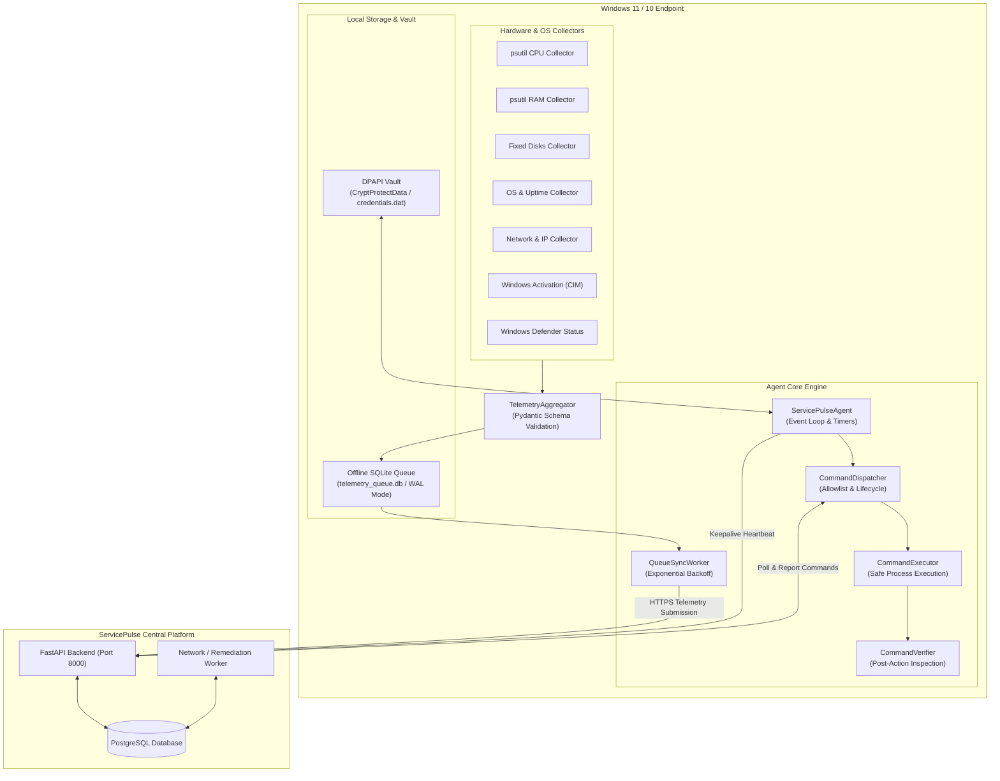

# ServicePulse Native Windows Agent — Technical Architecture

**Author:** Muhammadyusuf Usmonov  
**Target Environment:** Enterprise IT Operations  
**Component:** Native Windows Endpoint Agent  
**Platform:** Windows 11 / Windows 10 x64  
**Runtime:** Python 3.12 (Native / Standalone PyInstaller Executable)

---

## 1. Overview & Purpose

The **ServicePulse Windows Agent** is a native, resilient, and secure endpoint monitoring client designed for enterprise IT infrastructure. It operates continuously in the background to:

1. **Gather Genuine Telemetry:** Inspects real physical and virtual hardware metrics (CPU, RAM, Disks, Operating System, Network).
2. **Inspect Windows Licensing & Security:** Queries genuine Windows Activation status via WMI/CIM and Windows Defender antivirus/real-time protection via `Get-MpComputerStatus`.
3. **Persist Through Network Outages:** Utilizes a crash-resilient offline SQLite queue with Write-Ahead Logging (WAL) and automatic exponential backoff retry.
4. **Enforce Local Allowlist for Remediation:** Executes only strictly defined and validated safe operational actions (`restart_service`, `restart_servicepulse_agent`, `run_diagnostic_check`, `recheck_network_endpoint`, `notify_administrator`, `install_approved_software`). Arbitrary shell execution is mathematically prohibited.
5. **Support Dual Execution Modes:** Operates both in interactive Console mode for debugging/development and as a native background Windows Service managed via the Windows Service Control Manager (`services.msc`).

---

## 2. Architecture & Subsystems



---

## 3. Directory Layout

The Agent code is structured modularly within the repository:

```text
agent/
├── servicepulse_agent.py          # Root CLI entrypoint
├── requirements.txt               # Agent Python dependencies
├── pyproject.toml                 # Package definition & entrypoints
├── config.example.json            # Template configuration (no secrets)
├── servicepulse.spec              # PyInstaller build specification
├── build_agent.py                 # Standalone executable compiler
├── README.md                      # Agent quick start guide
│
├── servicepulse/                  # Agent core package
│   ├── __init__.py                # Package metadata (v1.0.0)
│   ├── main.py                    # CLI command router & argument parser
│   ├── config.py                  # Validated settings & path resolution
│   ├── agent.py                   # Core orchestrator & background thread loop
│   ├── api_client.py              # Synchronous HTTP client with retry logic
│   ├── authentication.py          # Windows DPAPI credential encryption
│   ├── enrollment.py              # Initial platform registration flow
│   ├── telemetry.py               # Telemetry aggregation & payload formatting
│   │
│   ├── collectors/                # Hardware & system metric gatherers
│   │   ├── __init__.py
│   │   ├── system.py              # psutil CPU, RAM, Disk, OS uptime
│   │   ├── windows_activation.py  # SoftwareLicensingProduct CIM queries
│   │   ├── defender.py            # Get-MpComputerStatus PowerShell collector
│   │   └── network.py             # Interfaces, IP, and MAC address resolution
│   │
│   ├── queue/                     # Persistent offline buffer
│   │   ├── __init__.py
│   │   ├── storage.py             # SQLite WAL queue with schema versioning
│   │   └── sync.py                # Exponential backoff synchronization
│   │
│   ├── commands/                  # Authorized remediation engine
│   │   ├── __init__.py
│   │   ├── allowlist.py           # Strict action and service allowlists
│   │   ├── schemas.py             # Pydantic parameter validation schemas
│   │   ├── execution.py           # Safe process runner (shell=False)
│   │   ├── verification.py        # Observable evidence verification
│   │   └── dispatcher.py          # Command polling, acknowledgment & lifecycle
│   │
│   ├── service/                   # Windows Service integration
│   │   ├── __init__.py
│   │   ├── windows_service.py     # win32serviceutil.ServiceFramework implementation
│   │   └── installer.py           # Service install/start/stop/uninstall manager
│   │
│   └── logging/                   # Logging & sanitization
│       ├── __init__.py
│       └── setup.py               # Rotating file logs with credential redaction
│
└── tests/                         # Comprehensive agent test suite (41 tests)
    ├── conftest.py                # Isolated fixtures & mock environments
    ├── test_collectors.py         # Hardware & Windows telemetry tests
    ├── test_telemetry.py          # Aggregator & Pydantic schema tests
    ├── test_offline_queue.py      # SQLite WAL, FIFO, corruption recovery tests
    ├── test_authentication.py     # DPAPI vault & enrollment tests
    ├── test_commands.py           # Action execution & parameter schema tests
    ├── test_security.py           # Shell injection & allowlist rejection tests
    ├── test_windows_service.py    # SCM metadata & query tests
    └── test_api_integration.py    # End-to-end integration against live Docker backend
```

---

## 4. Telemetry Collection Details

| Metric Subsystem | Mechanism | Output Fields | Resilience Strategy |
| :--- | :--- | :--- | :--- |
| **CPU** | `psutil.cpu_percent`, `cpu_count`, `cpu_freq` | `cpu_percent`, `core_count_logical`, `frequency_mhz` | Non-blocking interval sampling; returns 0.0 on error |
| **RAM** | `psutil.virtual_memory` | `ram_percent`, `ram_used_mb`, `ram_total_mb`, `ram_available_mb` | Converts raw bytes to MB; guarantees used <= total |
| **Disk** | `psutil.disk_partitions`, `disk_usage` | `disk_percent`, `disk_used_gb`, `disk_total_gb`, `disk_free_gb`, `drives` | Filters out removable media and CD-ROMs; aggregates fixed disks |
| **Operating System** | `platform`, `psutil.boot_time` | `hostname`, `os_name`, `os_version`, `build_number`, `uptime_seconds` | Cross-referenced against Windows registry and platform APIs |
| **Network** | `socket`, `psutil.net_if_addrs` | `primary_ip`, `interfaces`, `mac_address`, `speed_mbps` | UDP routing probe resolves primary outbound interface without packet egress |
| **Windows Activation** | PowerShell `Get-CimInstance SoftwareLicensingProduct` | `status` (`licensed`, `not_activated`, `in_grace_period`, `unavailable`), `partial_key` | 8s timeout; never collects full product keys; distinguishes unavailable from unactivated |
| **Windows Defender** | PowerShell `Get-MpComputerStatus` | `status` (`healthy`, `realtime_disabled`, `antivirus_disabled`, `signatures_outdated`, `unavailable`) | 8s timeout; read-only query; strictly prohibited from disabling protections |

---

## 5. Offline Queue & Crash Resilience

When network connectivity to the ServicePulse backend is severed:

1. **Zero Data Loss:** Telemetry collection continues on schedule.
2. **Transactional Storage:** Records are inserted into `telemetry_queue.db` within ACID transactions using SQLite Write-Ahead Logging (`PRAGMA journal_mode = WAL`).
3. **Idempotency Preservation:** Every enqueued record generates and preserves a unique `idempotency_key` (`tx_<uuid>`).
4. **Exponential Backoff:** The `QueueSyncWorker` uses exponential backoff with randomized jitter ($2.0\text{s} \times 2^n \pm 20\%$) to avoid overwhelming recovering network links.
5. **Safe Corruption Recovery:** If the SQLite database file experiences disk corruption, an automatic integrity check detects it, creates a timestamped backup (`.corrupt_<timestamp>`), and initializes a fresh healthy database without crashing the Agent process.
